# Kanpur Ki Kahaani — Team guide to the blog admin

This is for the team, not developers. It covers everything you need to write, publish and look after stories on **kanpurkikahaani.site**.

Only our team account (the kanpurkikahaani Google account) can get in. Everyone else can only read the site.

---

## 1. Signing in

1. Scroll to the very bottom of any page and click **Team login** (or go to `kanpurkikahaani.site/admin/login`).
2. Click **Continue with Google** and choose the **kanpurkikahaani** account.
   - Backup: type the same email and its password and click **Sign in with email**.
   - Forgot the password? Click **Forgot password?**, enter the team email, and use the link we email you to choose a new one.
3. If 2-step verification is on, type the 6-digit code from your authenticator app.

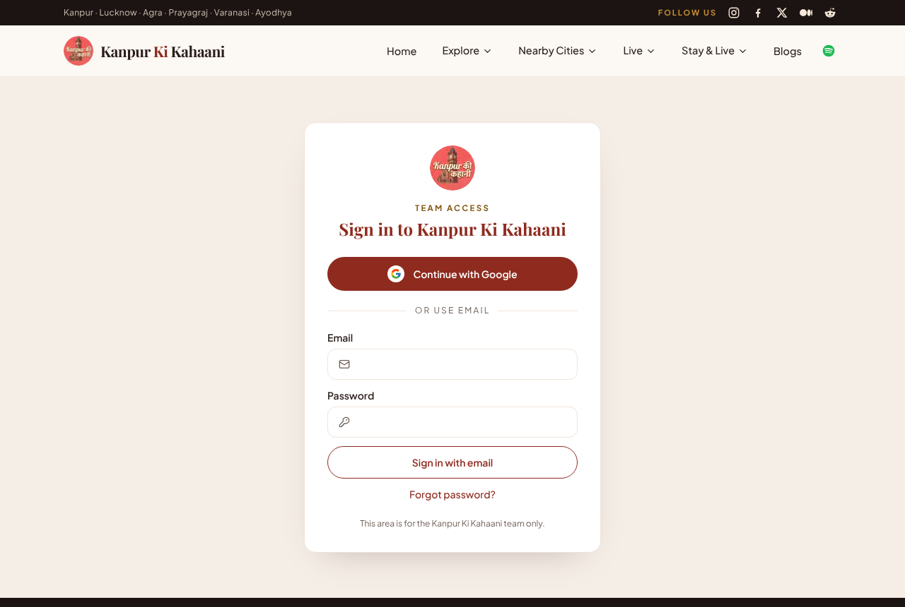

You stay signed in for up to 7 days, or 12 hours if you don't open the admin. After that you're asked to sign in again; that's normal.

## 2. The dashboard

After signing in you land on **Blogs**. **Admin** (top-left) opens the dashboard. It shows:
- how many posts are **Published**, **Drafts** and **Scheduled**;
- any **Broken links** found by the weekly link check;
- **Recent activity**, meaning who published, edited or deleted what.

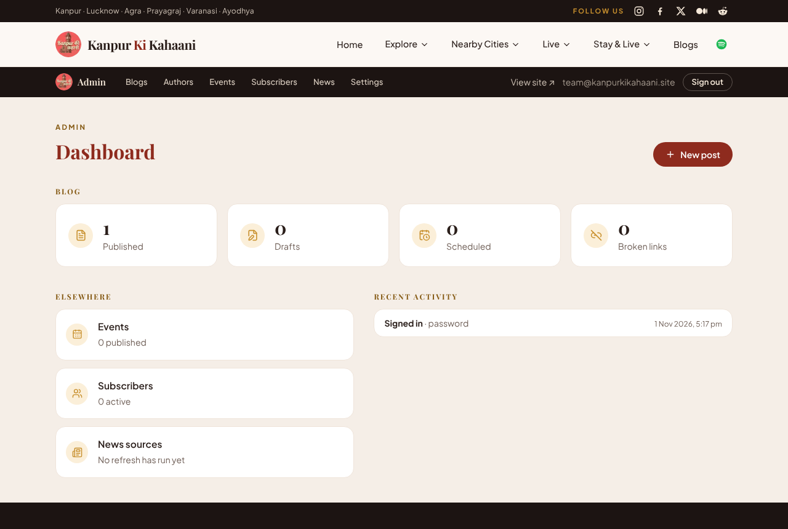

The dark bar at the top switches between **Blogs · Authors · Events · Subscribers · News · Settings**. **View site ↗** opens the public website, and **Sign out** is on the right.

## 3. Finding a post

**Blogs** lists every post with its cover, author, status, dates and link count.
- **Search** by title, filter by **Status**, and **Sort** by last edited, publish date or title.
- The buttons on each row are **Edit**, **Preview**, **Publish/Unpublish**, **Duplicate** and **Delete**.

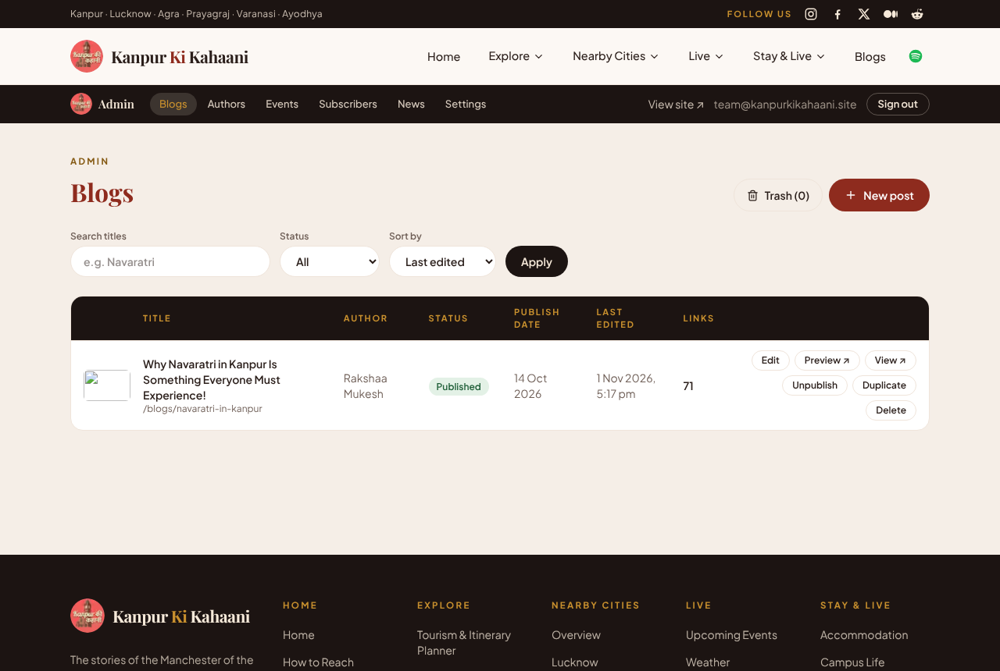

## 4. Writing a new post

Click **+ New post**. The left side is the page as readers will see it; the right side holds the settings. On a phone, the settings open from the **Settings** button at the bottom.

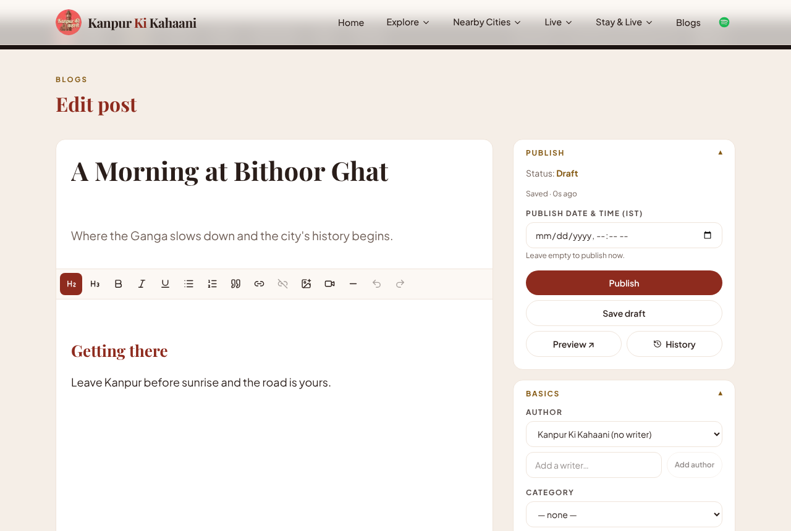

- **Title** (big field) and **Standfirst** (the sentence under the title).
- **Body**: just type. Shortcuts: `## ` + space makes a heading, `- ` starts a list, `> ` makes a quote.
- **Toolbar**: Heading 2/3, bold, italic, underline, lists, quote, link, remove link, image, YouTube, divider, undo/redo.
- **Your work saves itself** every 20 seconds and whenever you click away from a field. The panel says "Saved · 2s ago". If you try to leave with unsaved changes, the browser warns you.

### Paste from Word or Google Docs
Copy and paste: headings, bold, italics and links are kept, and fonts and colours are removed. Or click **Import .docx** under the editor to bring in a whole Word file. Then check the headings and links.

### Adding links (and reaching 100)
Select the words, click the **link** button and paste an address. For pages on our own site, start typing the page name (e.g. "touri") and pick it from the list.
- Links to other websites always open in a new tab. Links to our own pages open in the same tab, unless you tick **Open in new tab**.
- Use words that describe the page ("Navaratri on Wikipedia"), never "click here".

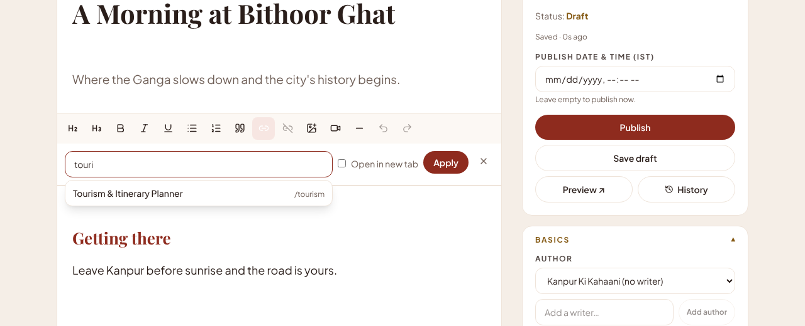

The **Links** panel on the right counts links toward the target of 100 and warns about duplicates, more than 2 links in one sentence, or vague link text. **Suggest links** offers ideas; nothing is added until you click **Accept**.

### Images and alt text
Click the **image** button, choose a JPG, PNG or WebP photo (max 5 MB; it's resized automatically), then:
- **Alt text** (required): describe what the photo shows for people who can't see it.
- **Caption** (optional): shown under the photo. Put the photo credit here, and write "Representative image" if it isn't really from the place in the story.

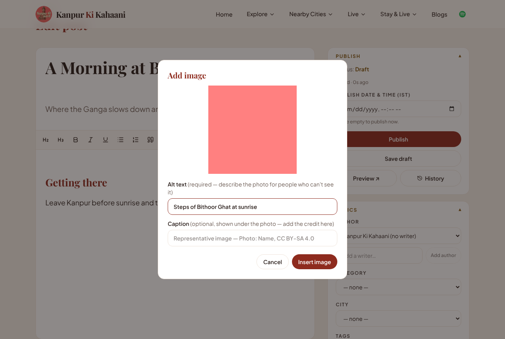

The **Cover image** section on the right works the same way. After uploading, click the most important part of the photo (the **focal point**) so it stays in view when the photo is cropped.

## 5. Preview, publish, schedule

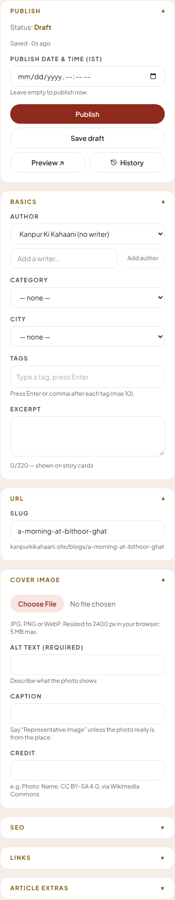

- **Preview ↗** saves and opens the post exactly as readers will see it, with a dark "Preview" strip at the top. Only you can open it, and the link expires after an hour.
- **Publish** puts the post live straight away. It appears on **Blogs** and the home page within seconds.
- **Schedule**: set a future **Publish date & time (IST)**; the button changes to **Schedule**. The post goes live by itself at that time.
- **Update** saves your changes to a live post.
- **Unpublish** takes a live post off the site and turns it back into a draft.

Changing the **URL (slug)** of a published post is safe: the old address automatically sends readers to the new one.

## 6. Editing a live post

- From the list: **Edit**.
- From the website: while you're signed in, every story shows a maroon **✎ Edit this post** button at the bottom right, and a thin bar at the top says "Signed in as team". Readers never see these.

### Restoring an older version
Click **History** in the publish panel. Every save that changed the title or text is listed (the last 50). Click **Restore this version** to go back. The current version is saved in History first, so nothing is lost.

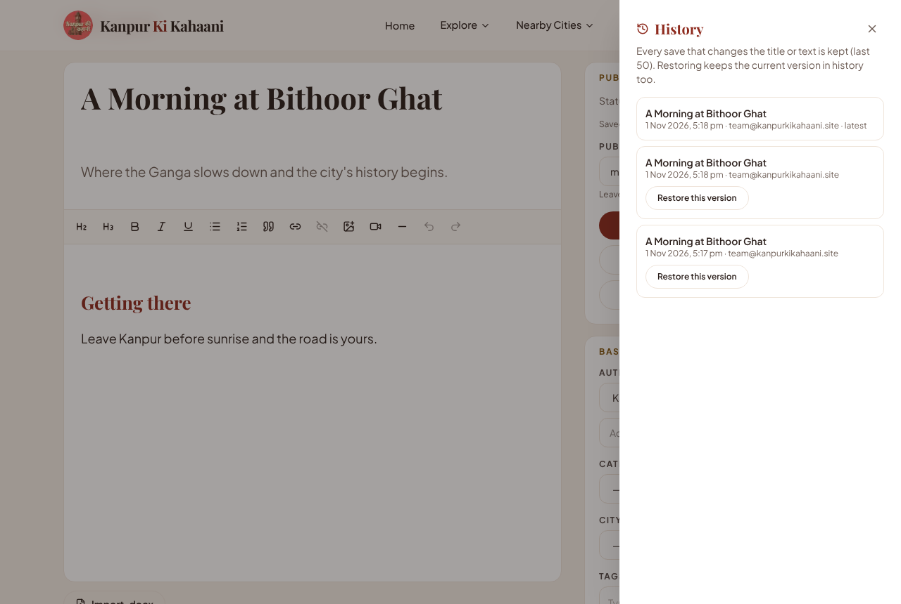

## 7. Deleting and restoring

**Delete** asks you to type the post's title, to make sure. The post then moves to the **Trash** and disappears from the website.
- **Blogs → Trash** lists deleted posts. **Restore** brings one back exactly as it was.
- Posts are deleted for good after 30 days in the Trash, or straight away with **Delete forever**.

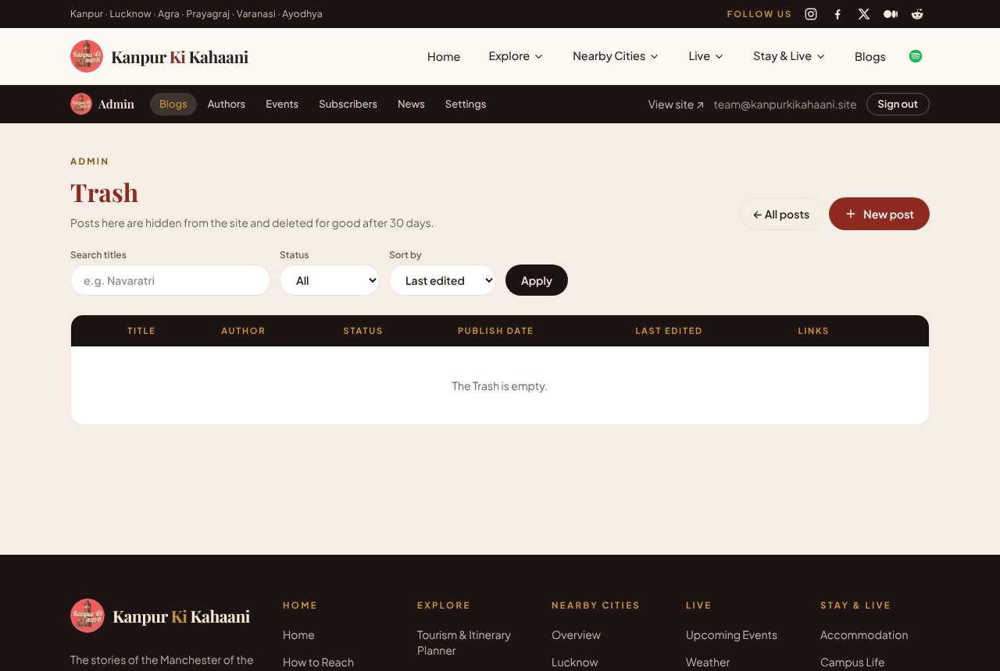

## 8. Settings, 2-step verification and the activity log

**Settings** shows:
- who is signed in;
- **2-step verification**: click **Enable**, scan the QR code with Google Authenticator, Microsoft Authenticator or 1Password, and type the code;
- the **Audit log**: every sign-in, publish, delete and restore, with the time. It can't be edited.

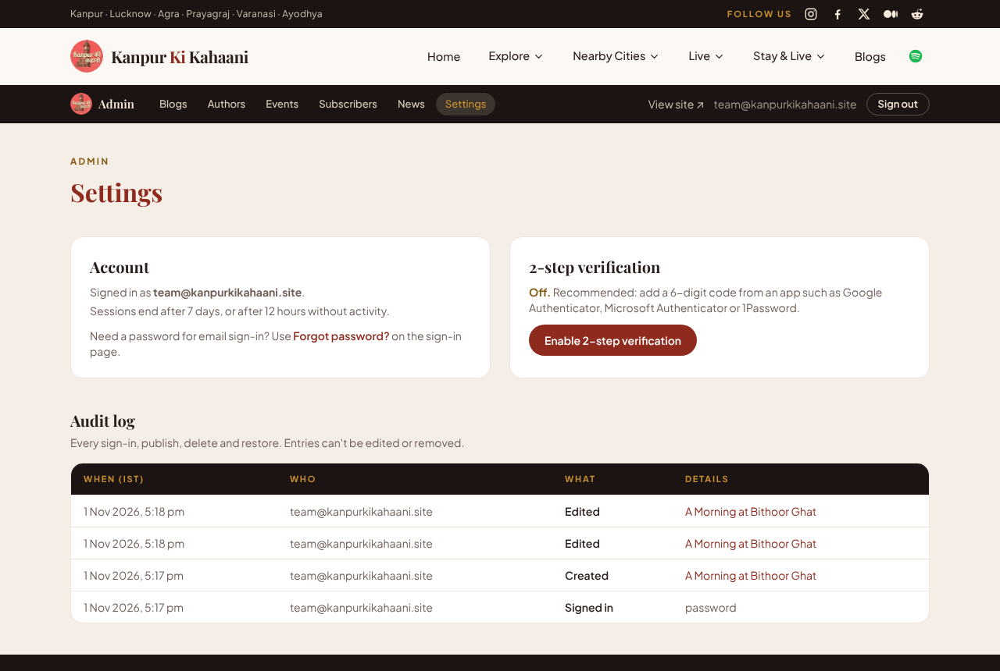

**Authors** lets you edit each writer's name, bio, photo, website and Instagram, or add a new writer.

## 9. Signing out

Click **Sign out** in the dark admin bar, or in the thin bar on the website. You go back to the blog. Using the browser's back button afterwards won't show the admin.

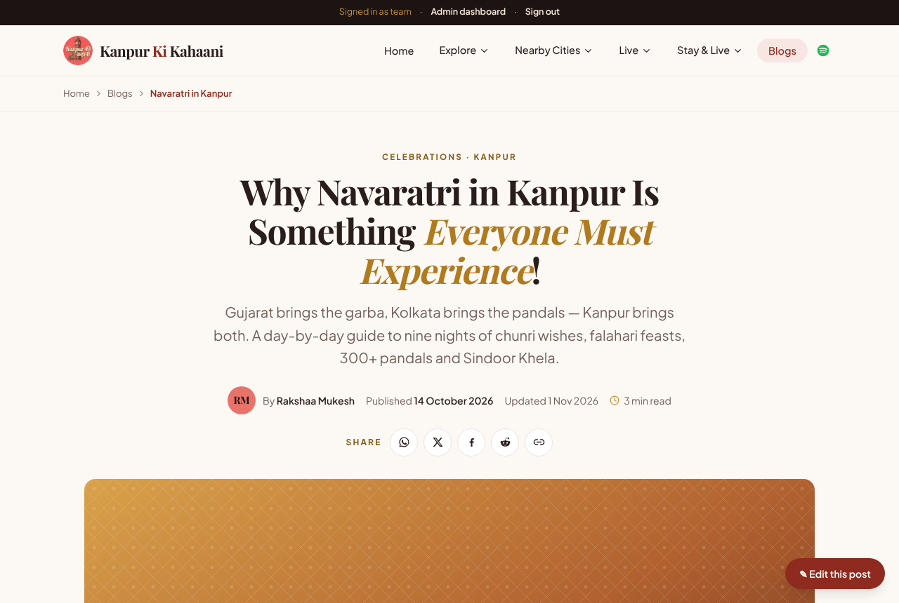

## 10. If sign-in doesn't work

- **"This account doesn't have team access."** You used a different Google account. Sign out of Google or choose the **kanpurkikahaani** account in the account picker.
- **"Too many attempts."** Wait the number of minutes shown, then try again (or use Google).
- **"That sign-in link has expired"**: reset links work once and expire. Ask for a new one.
- **"Sign-in isn't set up yet"**: the website's settings are missing in Vercel. Contact the developer.
- Lost your phone with the authenticator app? Contact the developer, who can remove the factor in Supabase (Authentication → Users).

For anything else, contact the developer with a screenshot and the time it happened.
